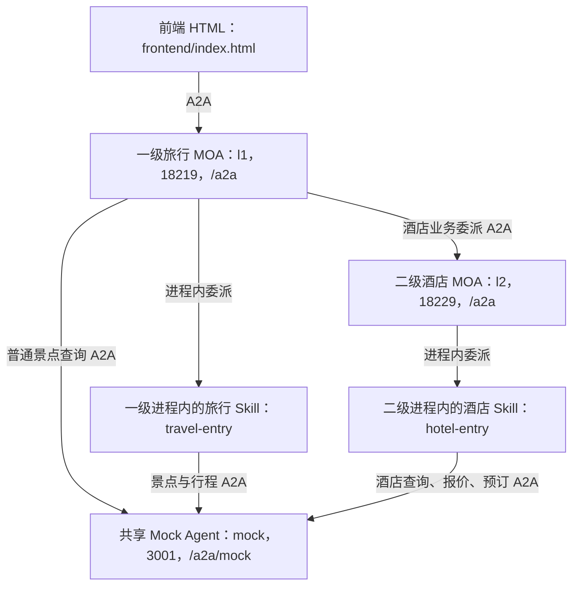

# MOA 旅行 Demo（agent-service-demo-moa）

移植自 agent-solution 仓 `common/agents/moa-agent-demo`：一个 Java 工程、一个可运行 JAR，使用三个进程演示 MOA 默认路由、本地 Skill、远端 MOA、补问、业务确认和服务带出。景点、酒店和预订均为虚构数据。solution 仓原件为准，本模块是 runtime 仓的测试用例 demo；同步方式为手工重拷源码后重做 pom 挂接差异。

依赖 solution 仓构建的 `com.openjiuwen:moa-agent`（当前 **0.1.3**，版本在 `pom.xml` 的 `moa-agent.version` 属性）。首次构建前需安装：

```bash
cd agent-solution-main
mvn install -pl common/agents/moa-agent -am -DskipTests
```

## 冒烟测试（零 LLM，默认运行）

仿照 deepagent 示例的 IT 方式，无需模型、Redis 或任何外部设施：

```bash
mvn -pl service/agent-service-demo/example/moa \
  -Dtest=MoaAgentDemoSmokeIT -Dsurefire.failIfNoSpecifiedTests=false test
```

`MoaAgentDemoSmokeIT` 以 mock profile 启动真实 HTTP 服务，用 runtime 的 A2A 客户端走完五步业务链：`attractions.search → trip.plan → hotel.search → hotel.quote → hotel.book`，逐步断言任务状态生命周期（SUBMITTED → WORKING → COMPLETED）、金额、确认文本绑定与预订去重。随包移植的 `DemoProfileTest`（l1/l2 装配）、`MockA2aInteropTest`（真实 Runtime SDK 调 Mock）、`MockBusinessServiceTest`（业务契约）也一并默认运行，全部使用假模型配置，不调用模型。

## 部署示意图



箭头表示请求方向，进度、补问和结果沿调用链返回。三个后端进程运行同一个 JAR，由 Profile 加载各自配置；Mock 不需要模型，L1/L2 需要模型服务。前端只连接一级 MOA。

## 构建

在仓库根目录执行（产物 `target/agent-service-demo-moa-0.1.4.jar`，随仓库 `${revision}` 走）：

```bash
mvn -pl service/agent-service-demo/example/moa clean package -DskipTests
```

## 启动

以下每段分别在一个 CMD 执行，**均先进入本 Demo 目录**（`service/agent-service-demo/example/moa`）。按 Mock → L2 → L1 的顺序启动。

Mock（3001，不需要模型）：

```cmd
java -jar target/agent-service-demo-moa-0.1.4.jar --spring.profiles.active=mock
```

L2 酒店 MOA（18229）与 L1 旅行 MOA（18219，各一个 CMD）：

```cmd
set LLM_PROVIDER=OpenAI
set LLM_API_KEY=你的密钥
set LLM_API_BASE=xxx
set LLM_MODEL=xxx
java -jar target/agent-service-demo-moa-0.1.4.jar --spring.profiles.active=l2
```

模型变量无默认值；密钥不写入仓库。运行工作目录位于 `target/workspaces/`，`mvn clean` 会清除本地工作目录。Skill 资产默认从当前目录的 `assets/tourism/skills` 加载；从其他目录运行时设置 `MOA_DEMO_ASSET_ROOT` 为该路径的绝对路径。

不需要 Python、Node.js、沙箱、数据库或额外网关。页面与消息、业务场景与执行路径、Mock 业务信封格式等同原版，详见 solution 仓 `common/agents/moa-agent-demo/README.md`。

## 实现位置

```text
example/moa/
├─ pom.xml                         # agent-service:${revision} 挂接、moa-agent 依赖、可运行包
├─ frontend/index.html             # 独立 A2A/SSE 页面
├─ assets/tourism/skills/
│  ├─ travel-entry/SKILL.md         # 旅行执行说明
│  ├─ hotel-entry/SKILL.md          # 查询、报价、确认、预订说明
│  └─ contracts/*.yml              # 五个操作的参数/结果 Schema
└─ src/
   ├─ main/java/com/moaagent/demo/
   │  ├─ MoaAgentDemoApplication.java
   │  ├─ config/                   # A2A Skill 与本地页面跨域配置
   │  └─ mock/                     # 单一 A2A 入口、虚构业务数据
   ├─ main/resources/
   │  ├─ application.yml           # 公共配置与模型环境变量
   │  ├─ application-{l1,l2,mock}.yml
   │  ├─ candidates/{l1,l2}.yaml    # 角色能力目录
   │  └─ prompts/demo-orchestration.md
   └─ test/java/                   # 冒烟 MoaAgentDemoSmokeIT + 装配、SDK 互通、业务契约
```
